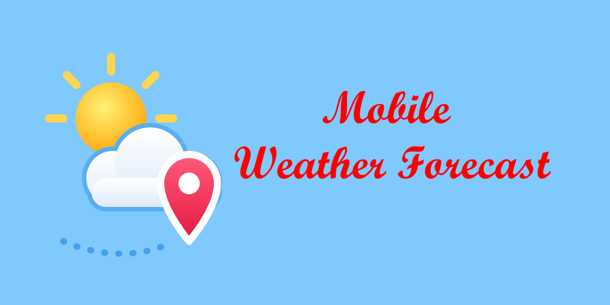

<p align="center">
  
</p>

# Mobile Weather Forecast

A Home Assistant integration that gives you the weather **where a person actually is**, not where the house is.

It follows the position of a smartphone or tablet running the Home Assistant Companion app, and builds a standard `weather` entity (current conditions, daily and hourly forecasts) plus a set of sensors, using the free [Open-Meteo](https://open-meteo.com/) API. No API key needed. Works anywhere in the world.

> Status: early version (0.2.0). Feedback and bug reports are welcome.

## Features

- Follows any entity that exposes a position: `person`, `device_tracker`, or the Companion app's *geocoded location* sensor.
- One `weather` entity with current conditions, **daily** and **hourly** forecasts, so the standard weather cards work out of the box.
- Sensors: condition (translated), temperature, feels like, humidity, precipitation, wind, wind gusts, pressure, place name, plus elevation and time zone (diagnostic).
- Place name: taken from the phone's own *geocoded location* sensor, or, if you enable it, looked up through OpenStreetMap (see [Place name and privacy](#place-name-and-privacy)).
- Refreshes on a regular interval (default 15 min) **and** immediately when the tracked entity moves more than 5 km.
- Falls back to your home position when the tracked entity has no coordinates.
- One entry per person: add the integration once for each phone or tablet.
- Translated in English and French (entity names, condition texts, setup form).

## Requirements

- Home Assistant 2025.2 or newer.
- A smartphone or tablet with the Home Assistant Companion app, with location tracking enabled. A fixed device (PC, server) would always give the weather of the same place.

## Installation

### Quick install (My Home Assistant buttons)

1. Open this repository in your Marketplace (Home Assistant 2026.11+) or in HACS (older versions) and install it:

   [](https://my.home-assistant.io/redirect/hacs_repository/?owner=jfvole-gif&repository=mobile_weather_forecast&category=integration)

2. Restart Home Assistant, then add the integration:

   [](https://my.home-assistant.io/redirect/config_flow_start/?domain=mobile_weather_forecast)

The buttons need [My Home Assistant](https://my.home-assistant.io/) to be set up with the address of your instance. If they do not work, follow the manual steps below.

### With the Marketplace (Home Assistant 2026.11 or newer)

1. Go to **Settings → Marketplace** and accept the warning the first time.
2. Search for **Mobile Weather Forecast** and select **Install**.
3. Add the integration under **Settings → Devices & services**.

If you cannot find it in the search, select **Add from link** and enter this repository (`owner/repository` or the full GitHub URL). Adding a repository from a link requires connecting your GitHub account to the Marketplace.

### With HACS (Home Assistant 2026.10 or older)

1. Open **HACS**, search for **Mobile Weather Forecast** and select **Download**.
2. Restart Home Assistant, then add the integration under **Settings → Devices & services**.

If you cannot find it in the search, add the repository by hand: in HACS, open the menu (⋮), choose **Custom repositories**, enter the URL of this repository with category **Integration**, then download it and restart Home Assistant.

### Manually

1. Copy the folder `custom_components/mobile_weather_forecast` into the `custom_components` folder of your Home Assistant configuration.
2. Restart Home Assistant.

## Setup

1. Go to **Settings → Devices & services → Add integration** and search for **Mobile Weather Forecast**.
2. Fill in the form:
   - **Name**: for example `Weather here Jeff`.
   - **Smartphone or tablet to follow**: the `person`, `device_tracker` or *geocoded location* sensor of the device.
   - **Update interval**: 5 to 180 minutes (15 by default).
   - **Show the place name** (optional, off by default): finds the city name through OpenStreetMap when the tracked entity does not provide it. See [Place name and privacy](#place-name-and-privacy).
3. Repeat for each person you want to follow.

The interval can be changed later in the integration options.

### Which entity should I pick?

| Entity | Works if… |
| --- | --- |
| `person.xxx` | the person is linked to a device tracker with GPS |
| `device_tracker.xxx_phone` | the Companion app reports location |
| `sensor.xxx_geocoded_location` | it has a `location` attribute (`[latitude, longitude]`) |

The integration reads `latitude`/`longitude` attributes, or a `location` attribute holding `[latitude, longitude]`.

## Entities

For a device named *Weather here Jeff*:

| Entity | Description |
| --- | --- |
| `weather.weather_here_jeff` | current conditions + daily/hourly forecasts |
| `sensor.weather_here_jeff_condition` | condition as a translated text |
| `sensor.weather_here_jeff_temperature` | temperature (°C) |
| `sensor.weather_here_jeff_feels_like` | apparent temperature (°C) |
| `sensor.weather_here_jeff_humidity` | relative humidity (%) |
| `sensor.weather_here_jeff_precipitation` | precipitation (mm) |
| `sensor.weather_here_jeff_wind` | wind speed (km/h) |
| `sensor.weather_here_jeff_wind_gusts` | wind gusts (km/h) |
| `sensor.weather_here_jeff_pressure` | sea-level pressure (hPa) |
| `sensor.weather_here_jeff_place` | place name (city), with region, country and source as attributes |
| `sensor.weather_here_jeff_elevation` | elevation of the position (m), diagnostic |
| `sensor.weather_here_jeff_time_zone` | time zone, diagnostic |

Entity IDs depend on the name you chose and on your Home Assistant language. The `weather` entity also exposes the attributes `tracked_entity`, `tracked_latitude`, `tracked_longitude`, `tracked_source` (`entity` or `home` when falling back), `locality`, `timezone` and `elevation`.

## Examples

### Get the forecast in an automation or script

```yaml
action: weather.get_forecasts
target:
  entity_id: weather.weather_here_jeff
data:
  type: daily
response_variable: forecast
```

### Home weather at home, local weather on the move

```yaml
type: vertical-stack
cards:
  - type: conditional
    conditions:
      - condition: state
        entity: person.jeff
        state: home
    card:
      type: weather-forecast
      entity: weather.my_home_weather
  - type: conditional
    conditions:
      - condition: state
        entity: person.jeff
        state_not: home
    card:
      type: weather-forecast
      entity: weather.weather_here_jeff
```

## Place name and privacy

The place sensor (and the `locality` attribute of the weather entity) is filled in this order:

1. **From the tracked entity itself**, when it provides a locality: the Companion app's *geocoded location* sensor does. Nothing extra is sent anywhere.
2. **Otherwise, only if you enable "Show the place name"** in the setup or in the options: the position, rounded to about 1 km, is sent to [Nominatim](https://nominatim.org/) (OpenStreetMap) to find the city. The result is cached and the lookup is only repeated after a move of about 2 km. Requests are spaced by at least one second and carry a User-Agent identifying this project, as the Nominatim usage policy requires.
3. **If neither applies**, the place sensor stays unknown.

The weather itself always needs your position, rounded to about 1 km, to be sent to Open-Meteo. Place names from Nominatim are © OpenStreetMap contributors (ODbL). The public Nominatim service is meant for light use: personal use with a few devices is fine, but do not run this integration at scale against it.

## Limitations

- Forecasts come from Open-Meteo, which blends several weather models. They are good in general but may be less accurate than a national weather service for very local phenomena. Keep your national provider for your home if you want the best local data.
- No official weather alerts: the integration only provides forecasts.
- Open-Meteo's free API is intended for non-commercial use and requires attribution (CC BY 4.0). Please check their [terms](https://open-meteo.com/en/terms) before using or redistributing this integration beyond personal use.

## Troubleshooting

Enable debug logs in `configuration.yaml`:

```yaml
logger:
  logs:
    custom_components.mobile_weather_forecast: debug
```

Then check **Settings → System → Logs**.

- `tracked_source: home` on the weather entity means the tracked entity has no usable coordinates, so the home position is used.
- Weather does not change when you travel: check that location tracking is enabled in the Companion app and that the tracked entity updates.

## Adding a language

Copy `custom_components/mobile_weather_forecast/translations/en.json` to `<language code>.json` (for example `de.json`) and translate the texts. No code change is needed.

## Versioning

The version number follows [Semantic Versioning](https://semver.org/) and is defined in `manifest.json`. A build identifier (`YYYYMMDD-N`) is defined in `const.py`. Both appear on the device page in Home Assistant (for example `0.2.0 (build 20261121-1)`) and in the log at startup. See the [changelog](CHANGELOG.md).

**Releasing a new version:** update `version` in `manifest.json`, update `BUILD` in `const.py`, add an entry to `CHANGELOG.md`, then create a GitHub release with a matching tag (for example `v0.2.0`) so that HACS shows it.

## Credits

Weather data by [Open-Meteo.com](https://open-meteo.com/). Optional place names: © [OpenStreetMap](https://www.openstreetmap.org/copyright) contributors, via [Nominatim](https://nominatim.org/).

---

## Résumé en français

**Mobile Weather Forecast** donne la météo de l'endroit où se trouve réellement une personne (smartphone ou tablette avec l'appli Companion), via l'API gratuite Open-Meteo, sans clé. Elle crée une entité `weather` (conditions actuelles, prévisions journalières et horaires) et des capteurs (condition, température, ressenti, humidité, précipitations, vent, rafales, pression).

- **Installation** : par la recherche du Marketplace de Home Assistant (2026.11 ou plus récent, *Paramètres → Marketplace*) ou de HACS (versions plus anciennes) ; en secours, en ajoutant le dépôt comme dépôt personnalisé (catégorie *Intégration*) ; ou en copiant `custom_components/mobile_weather_forecast` dans votre dossier `custom_components`, puis redémarrer Home Assistant.
- **Configuration** : *Paramètres → Appareils et services → Ajouter une intégration → Mobile Weather Forecast*. Choisissez l'entité du smartphone ou de la tablette (`person`, `device_tracker` ou capteur *geocoded location*).
- **Mise à jour** : toutes les 15 minutes par défaut, et immédiatement si l'appareil se déplace de plus de 5 km.
- **Nom du lieu** : repris du capteur de localisation du smartphone, ou, en option (désactivée par défaut), trouvé via Nominatim / OpenStreetMap avec une position arrondie à environ 1 km.
- **Interface** : textes disponibles en français et en anglais.
